# COB 2 — Infrastructure Workflow Automation with CI/CD

**Beejan Technologies · Data Engineering**

A production data platform provisioned entirely through [COB](https://github.com/alexanderchosen/cob-modules-platform), the company's internal AWS provisioning platform, and deployed through an automated Terraform pipeline with formatting, validation, planning, human review, and gated application.

---

## Contents

- [The problem this solves](#the-problem-this-solves)
- [Repository layout](#repository-layout)
- [Architecture](#architecture)
- [Part A — Consuming COB](#part-a--consuming-cob)
- [Part B — The CI/CD pipeline](#part-b--the-cicd-pipeline)
- [Using the pipeline](#using-the-pipeline)
- [Demonstrations](#demonstrations)
- [Part C — Production engineering practices](#part-c--production-engineering-practices)
- [Platform capability gaps](#platform-capability-gaps)
- [Engineering decisions and trade-offs](#engineering-decisions-and-trade-offs)
- [Lessons learned](#lessons-learned)
- [Getting started](#getting-started)

---

## The problem this solves

COB solved *how infrastructure gets built*. It did not solve *how infrastructure gets changed*.

Before this project, provisioning still depended on an engineer running `terraform validate`, `terraform plan` and `terraform apply` by hand. That engineer had to remember the right commands, run them in the right directory, read the output carefully, and decide when to apply. Nothing stopped an unreviewed change reaching production, nothing recorded who authorised a deployment, and nothing prevented two people applying against the same state at once.

This project replaces *"an engineer runs Terraform"* with *"a reviewed change is applied by a pipeline, and production waits for a named human."*

It does this while being a **customer** of COB rather than a second platform: every AWS resource here is provisioned through a published, versioned COB module.

---

## Repository layout

```
cob-consumer-platform/
├── .github/workflows/
│   ├── terraform-plan.yml      CI — runs on every pull request
│   └── terraform-apply.yml     CD — runs on merge to main
├── environments/
│   ├── dev/                    data platform, auto-applies on merge
│   └── prod/                   data platform, gated behind human approval
├── examples/consumers/
│   └── app_engineering/        COB 1 reference consumer — validated, never deployed
├── docs/
│   ├── test_data/              seed datasets
│   └── images/                 evidence screenshots
└── README.md
```

Two repositories, not one:

| Repository | Owns | Consumed as |
| --- | --- | --- |
| [`cob-modules-platform`](https://github.com/alexanderchosen/cob-modules-platform) | The seven capability modules | Released git tags |
| `cob-consumer-platform` (this repo) | Environments, pipeline, data platform | — |

The consumer never edits module code. It calls published versions:

```hcl
source = "git::https://github.com/alexanderchosen/cob-modules-platform.git//modules/s3?ref=v1.0.0"
```

The `?ref=v1.0.0` is the contract. Platform Engineering can merge whatever they like into their `main`; this repository stays on v1.0.0 until someone deliberately edits that line — and because it is a line in a `.tf` file, that edit goes through a pull request, a plan, and a review like any other infrastructure change.

---

## Architecture

### Delivery pipeline and trust boundaries


**How to read it.** Green jobs need no AWS credentials at all — `fmt` and `validate` run with `init -backend=false`, so a syntax error fails in about twenty seconds without one cloud API call. The dotted arrows carry the real OIDC subject claims. The three hexagonal locks sit on the critical path: no line can be traced from pull request to production infrastructure that bypasses all three.

### The provisioned data platform

Identical in shape for `dev` and `prod`; only input values and state keys differ.
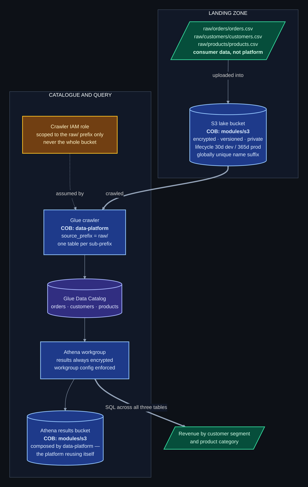


Every box is tagged with the COB module that provisioned it. Nothing in the data platform was hand-built around the platform.

### Environment isolation


---

## Part A — Consuming COB

### What was built

A small data lake: one governed landing bucket holding three related retail datasets, catalogued automatically by AWS Glue, and queryable in Athena with SQL — including joins across all three tables.

```
s3://cob-data-eng-<env>-s3-datalake-<suffix>/
└── raw/
    ├── orders/orders.csv          24 rows
    ├── customers/customers.csv     8 rows
    └── products/products.csv       6 rows
```

A single Glue crawler pointed at `raw/` treats each immediate sub-prefix as a separate table, so one `data-platform` module call produces three catalogued tables in one Glue database — rather than three module calls producing three databases, three Athena workgroups and three results buckets.

### How the consumer calls COB

The entire data platform is two module calls and three object uploads.

```hcl
module "lake" {
  source = "git::https://github.com/alexanderchosen/cob-modules-platform.git//modules/s3?ref=v1.0.0"

  name_prefix         = "${var.project}-${var.environment}-s3"
  purpose             = "datalake"
  data_classification = "internal"
  enable_versioning   = true
  lifecycle_days      = var.lifecycle_days
}

resource "aws_s3_object" "seed" {
  for_each = local.datasets

  bucket = module.lake.bucket_name
  key    = "raw/${each.key}/${each.value}"
  source = "${path.module}/../../docs/test_data/${each.value}"
  etag   = filemd5("${path.module}/../../docs/test_data/${each.value}")
}

module "analytics" {
  source = "git::https://github.com/alexanderchosen/cob-modules-platform.git//modules/data-platform?ref=v1.0.0"

  name_prefix        = "${var.project}-${var.environment}-data"
  purpose            = "retail-analytics"
  source_bucket_arn  = module.lake.bucket_arn
  source_bucket_name = module.lake.bucket_name
  source_prefix      = "raw/"
  crawler_schedule   = var.crawler_schedule

  depends_on = [aws_s3_object.seed]
}
```

Two lines of intent — `purpose` and `data_classification` — produce an encrypted, versioned, lifecycle-managed, publicly-inaccessible bucket with a globally unique name. Four lines produce a Glue database, a crawler with an IAM role scoped to one prefix, an Athena workgroup with enforced result encryption, and a separate encrypted results bucket. The consumer makes no security decisions.

**On `depends_on`:** Terraform infers dependencies from references, and `data-platform` references the *bucket*, not the objects. Without the explicit dependency, Terraform is free to create the crawler and the objects in parallel; if the crawler's first run wins the race it catalogues an empty prefix and creates no tables — a successful apply with an empty catalogue.

### Proof the platform works

A successful `terraform apply` proves Terraform reported success. It does not prove the platform functions. Both environments were verified end to end with a three-table join.

```sql
SELECT
    c.segment,
    p.category,
    COUNT(*)                        AS order_count,
    SUM(o.quantity * p.unit_price)  AS revenue_ngn
FROM orders o
JOIN customers c ON o.customer_id = c.customer_id
JOIN products  p ON o.product_id  = p.product_id
WHERE o.status = 'delivered'
GROUP BY c.segment, p.category
ORDER BY revenue_ngn DESC;
```

<!-- IMAGE: Athena dev workgroup, query editor showing the three tables and customers columns -->
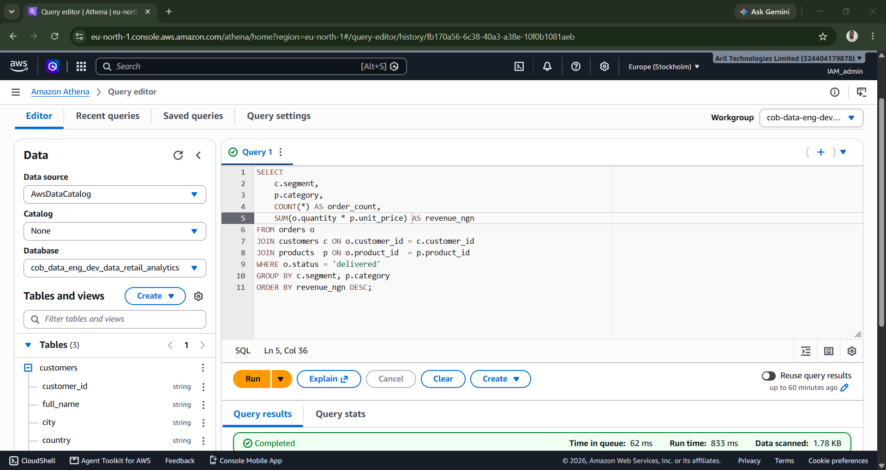

**Dev environment — Glue catalogue showing `customers`, `orders`, `products` with correctly inferred column names.**

<!-- IMAGE: Athena prod workgroup, query editor with the join query, workgroup cob-data-eng-pro... -->
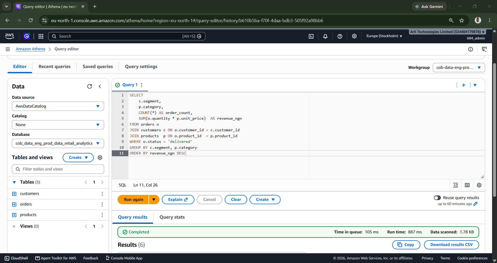
**Prod environment — the same join running against the `cob_data_eng_prod_data_retail_analytics` database in the prod workgroup.**

<!-- IMAGE: Athena prod results, 6 rows, wholesale/power 4380000 etc -->
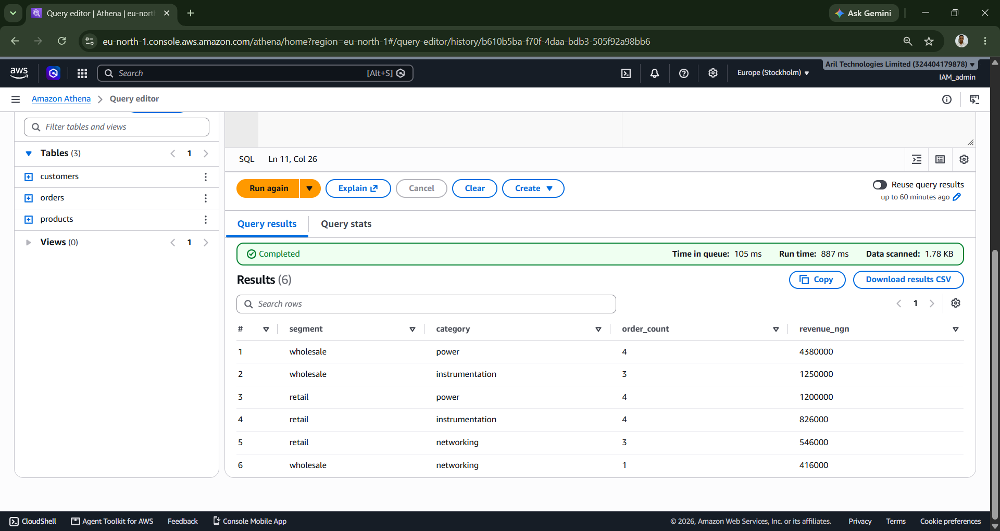
**Six rows returned, 1.78 KB scanned. Revenue by customer segment and product category, joined across three independently catalogued CSV datasets.**

---

## Part B — The CI/CD pipeline

Two workflows. The first proves a change is safe; the second applies it.

### `terraform-plan.yml` — continuous integration

Triggered on every pull request targeting `main`. Three tiers, cheapest first.

| Job | AWS? | Catches |
| --- | --- | --- |
| `Format check` | No | Formatting drift, repo-wide |
| `Validate environments/dev`<br/>`Validate environments/prod`<br/>`Validate examples/consumers/app_engineering` | No | Syntax and type errors in every root module |
| `Plan dev`<br/>`Plan prod` | Read-only | What would actually change |

The plan jobs declare `needs: [fmt, validate]`, so a repo that fails a twenty-second local check never consumes an AWS round trip.

Each plan is posted to the pull request as a comment that updates in place, so pushing five times leaves two current comments rather than ten historical ones.

<!-- IMAGE: PR #1 conversation showing both github-actions bot plan comments -->
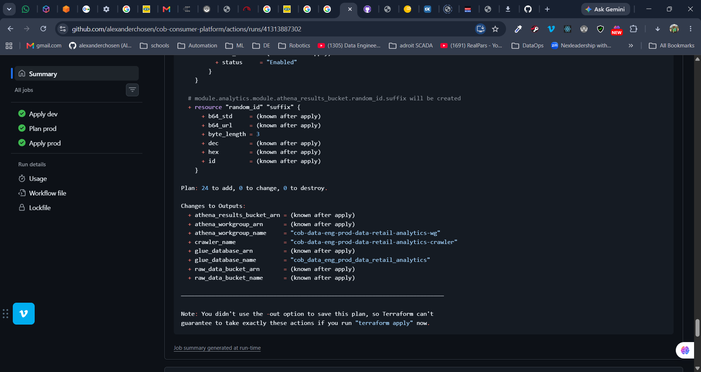
**Both plans published to the pull request. Dev reports no changes; prod reports changes requiring review. Each carries the commit SHA it was generated from.**

<!-- IMAGE: PR #1 "All checks have passed, 6 successful checks" with merge enabled -->
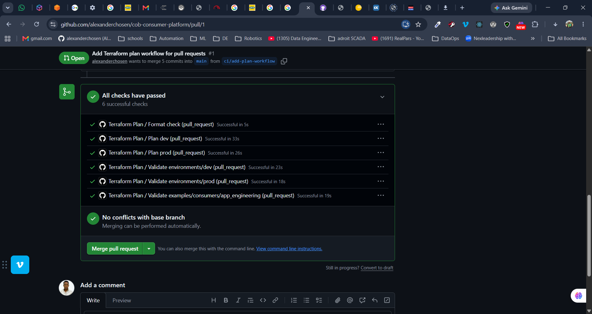
**All six required checks green.**

### `terraform-apply.yml` — review gate and continuous delivery

Triggered on push to `main` — that is, on merged pull requests — and manually via `workflow_dispatch`. Four jobs in sequence:

```
apply dev  →  plan prod  →  [ APPROVAL ]  →  apply prod
```

`plan-prod` exists so the reviewer has something to read. If `apply-prod` planned internally, the approval request would arrive before any plan existed. Instead the plan is generated and published to the run summary first, and only then does the gated job wait.

Prod is also downstream of dev: if `apply-dev` fails, prod is never reached.

---

## Using the pipeline

### Making an infrastructure change

```bash
git checkout main
git pull origin main
git checkout -b feature/my-change

# edit environments/dev/main.tf, environments/prod/main.tf, tfvars, …

terraform fmt -recursive    # keeps the format check green
git add .
git commit -m "Describe the change"
git push -u origin feature/my-change
```

Open a pull request against `main`. Then:

1. **Wait for the six checks.** They take two to four minutes.
2. **Read the two plan comments.** Expand *Show plan* and check the resource counts and any destroys.
3. **Request a review.** A second person must approve; GitHub does not permit the author to approve their own pull request.
4. **Merge.** The apply workflow starts automatically.
5. **Watch the Actions tab.** `Apply dev` runs, `Plan prod` publishes its plan, and `Apply prod` pauses.
6. **Review the prod plan in the run summary, then click *Review deployments* → *prod* → *Approve and deploy*.**


### Re-running without a code change

**Actions → Terraform Apply → Run workflow → main.** The same gates apply — `workflow_dispatch` does not bypass the environment approval.

### Where things live

| | |
| --- | --- |
| Region | `eu-north-1` |
| State bucket | `alexander-cob-tfstate-2026`, versioned and encrypted |
| State keys | `data-platform/dev/terraform.tfstate`, `data-platform/prod/terraform.tfstate` |
| Plan role | `cob-oidc-plan` — `ReadOnlyAccess` |
| Apply role | `cob-oidc-apply` — `AdministratorAccess`, environment-scoped trust policy |
| Terraform | pinned to 1.10.5 in both workflows |

---

## Demonstrations

### Scenario A — a valid infrastructure change

A change is opened as a pull request, the plans are published, the checks pass, a reviewer approves, the change merges, dev applies automatically, and prod waits for a deployment approval.

<!-- IMAGE: PR #1 header with 5 commits, 6 checks, 14 files changed -->
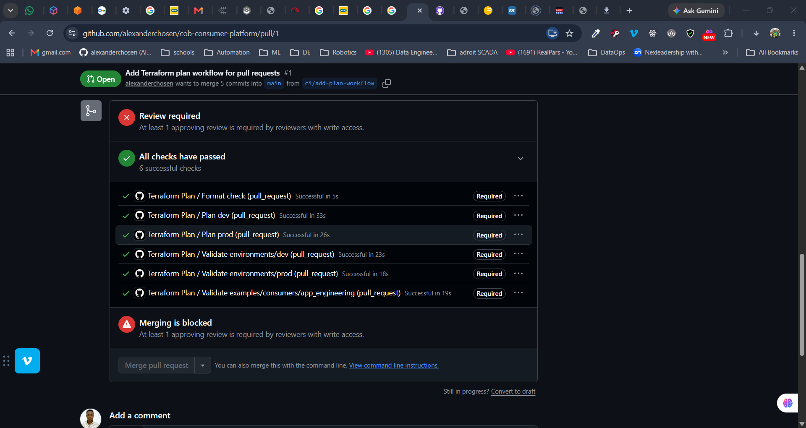
**The pull request that introduced the plan workflow.**

<!-- IMAGE: Review required + Merging is blocked, with all 6 Required badges -->
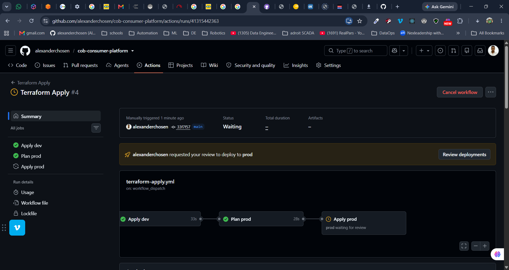
**All six checks green and merging still blocked: branch protection requires an approving review from a second person with write access. Note the `Required` badge against each check.**

<!-- IMAGE: Terraform Apply run 41313887302, three jobs green -->
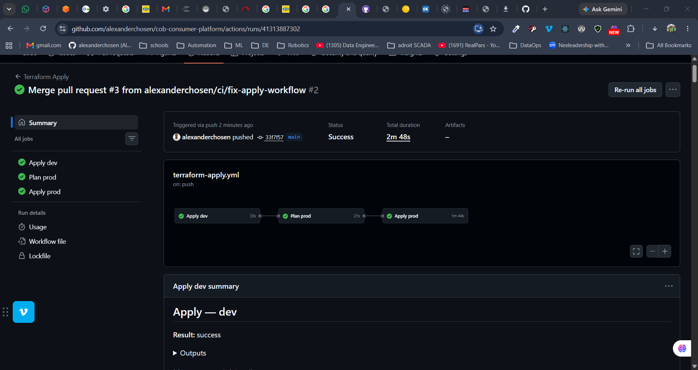
**The apply workflow after merge: dev applied, prod planned, prod applied following approval.**

<!-- IMAGE: Apply prod summary — Result success, Triggered by alexanderchosen, outputs -->
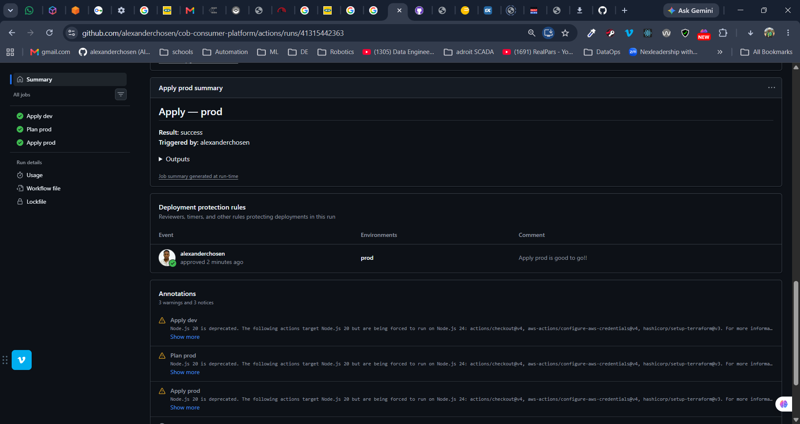
**Prod outputs after a gated apply — the lake bucket, Glue database, Athena workgroup, crawler and encrypted results bucket, all named for the prod environment.**

### Scenario B — invalid Terraform

Two different classes of error were introduced deliberately, and each was caught at a different tier.

**B1 — a syntax error** in `environments/dev/main.tf` (an unclosed `module` block, which Terraform reported as a reserved block name because the following `locals` block was absorbed into it).

<!-- IMAGE: Validate environments/dev failed — Reserved block type name in module block, locals -->
![Validation failure!(docs/images/format-check-error.png)]
**`Validate environments/dev` fails during `terraform init -backend=false`, before any AWS credential is requested.**

<!-- IMAGE: PR #4 — 1 failing, 1 skipped, 2 expected, 3 successful; merge blocked -->
![Merge blocked by failing checks!(docs/images/format-check-failed-test.png)]
**The plan jobs never ran — `needs: [fmt, validate]` prevented them. They sit as `Expected — Waiting for status to be reported`, so the required checks can never report and the merge stays blocked. An engineer cannot merge a change simply because the Terraform looks correct.**

**B2 — a semantic error**: `lifecycle_days = -5` in `environments/dev/terraform.tfvars`. Syntactically valid, so formatting and validation both pass. It is rejected by the module's own `validation` block at plan time.

<!-- IMAGE: commit 9cf3073 — 5 successful and 1 failing; Plan dev failing, Plan prod successful -->
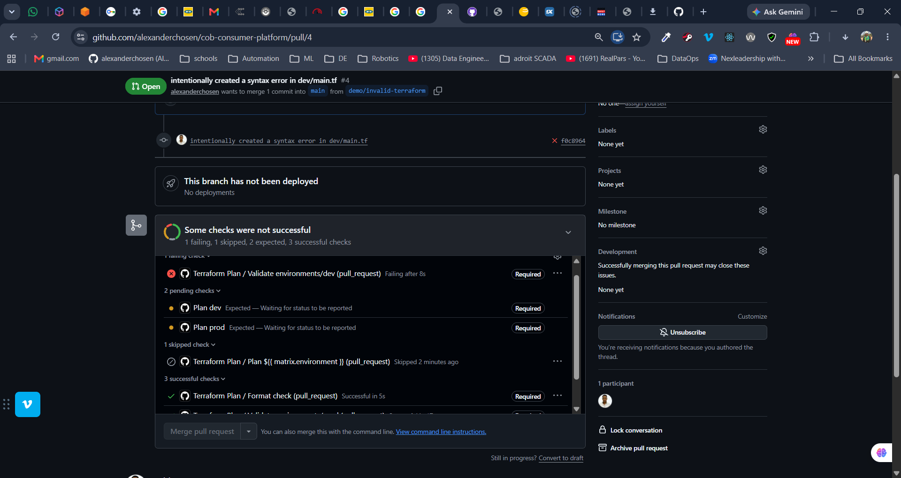
**`Format check`, both `Validate` jobs and `Plan prod` all pass. Only `Plan dev` fails — because only dev's inputs were invalid. Shared checks are repo-wide; plans are per-environment; a single failure still blocks the merge.**

<!-- IMAGE: Plan dev job steps showing "Fail job if plan errored" red -->
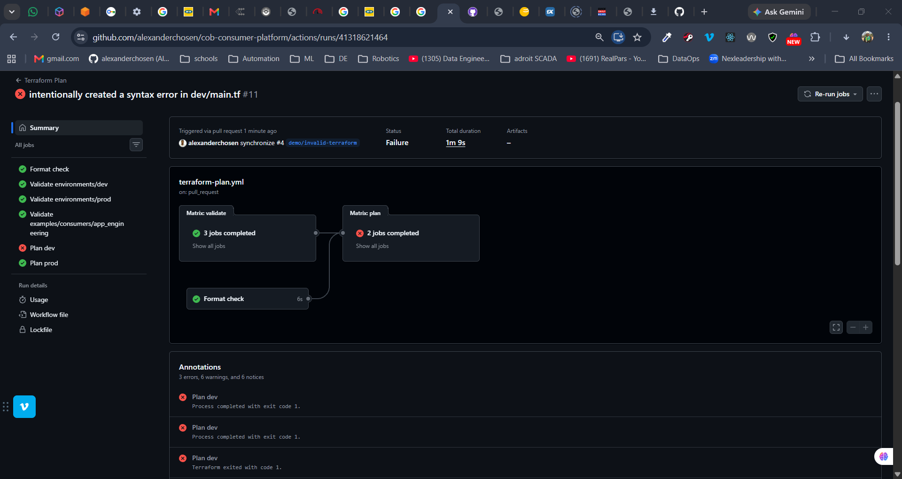
**The plan step uses `continue-on-error` so the failure can still be published to the pull request; the final step then fails the job so the check goes red.**

### Scenario C — repeatability, no changes required

The workflow was re-run against an unchanged environment.

<!-- IMAGE: Plan prod summary — "No changes. Infrastructure matches configuration." with refreshing state lines -->

**`terraform plan -detailed-exitcode` returns 0, and the pipeline states plainly that infrastructure matches configuration. The approval gate still engages — an unchanged plan is still a deployment, and is still reviewed.**

### The approval gate

<!-- IMAGE: Terraform Apply #4 Waiting — "alexanderchosen requested your review to deploy to prod" + Review deployments -->

**`Apply prod` held in `Waiting`. The job has not started, holds no credentials, and cannot obtain them until a required reviewer approves.**

<!-- IMAGE: Deployment protection rules — requested review row -->


<!-- IMAGE: Deployment protection rules — approved 2 minutes ago, comment "Apply prod is good to go!!" -->

**The approval is recorded against the run with the approver, the environment, the timestamp and a comment — an auditable record of who authorised the deployment and when.**

---

## Part C — Production engineering practices

### Four independent locks

Each is sufficient on its own to stop an unreviewed change reaching production. Removing any one leaves the others standing.

1. **Branch protection on `main`** — no direct pushes, every change arrives by pull request, one approving review required, stale approvals dismissed when new commits are pushed, branches must be up to date before merging, force pushes and deletions blocked.
2. **Six required status checks** — formatting, validation of all four root modules, and both environment plans must report green before the merge button unlocks.
3. **Environment approval on `prod`** — a required reviewer must approve before the apply job starts, with the plan already published in the run. The `prod` environment is restricted to the `main` branch, so it cannot be targeted from a feature branch.
4. **AWS trust policy** — the apply role is assumable only when the OIDC subject contains `environment:dev` or `environment:prod`, matched with `StringEquals` and no wildcard.

### Two controls, two questions

These are frequently conflated. They are not the same thing:

> **Code review** asks *should this change exist?* It happens on the pull request, before merge, and GitHub prohibits the author from answering it.
>
> **Deployment approval** asks *should this plan be applied to production?* It happens after merge, with the plan rendered in the run, and GitHub permits the author to answer it — because reviewing a rendered plan is a different act from reviewing a diff.

They are independent. Weakening one does not weaken the other.

### Credentials

- **No long-lived AWS credentials exist anywhere in GitHub.** No access keys, no secrets. GitHub mints a short-lived OIDC token per job; AWS exchanges it for temporary credentials valid for about an hour.
- **Separate roles for separate powers.** Plan jobs assume a `ReadOnlyAccess` role; apply jobs assume a write role. A plan running on an unreviewed feature branch physically cannot modify infrastructure.
- **The apply role's trust policy is scoped to environments**, not branches or wildcards. Because GitHub only issues an `environment:` subject to a job that declares one, and such a job cannot start before approval, **the approval is a precondition for obtaining write credentials** — enforced by AWS, not by workflow YAML that a pull request could edit.
- **Workflow permissions default to read-only** at the workflow level and are raised per job only where needed. `fmt` and `validate` cannot request an OIDC token at all.
- **GitHub Actions cannot approve pull requests** — the organisation setting is disabled, so the required review must come from a person.

### State

- **Versioned state bucket.** State is overwritten in place on every apply and has no internal history; versioning is the only undo for a corrupted or truncated write.
- **Encrypted at rest, public access fully blocked.** State contains resource IDs, ARNs and security group rules.
- **Separate state key per environment** — `data-platform/dev/` and `data-platform/prod/` in one bucket. A mistake in one cannot touch the other.
- **Native S3 state locking** (`use_lockfile = true`, Terraform ≥ 1.10) on every apply, so conflicting deployments queue rather than race. Combined with `concurrency` groups that never cancel an apply in flight.

### Pipeline hygiene

- **Terraform version pinned exactly** (1.10.5) in both workflows, so runs are reproducible and cannot drift with upstream releases.
- **Command output is passed into shell steps via `env:`, never by direct `${{ }}` interpolation.** Interpolated expressions are substituted into the script text before the shell parses it, so output containing shell metacharacters would be executed as code. This is also a genuine injection vector where the value is attacker-influenced, such as a pull request title or branch name.
- **The plan is published as rendered text, not as a workflow artifact.** A binary plan file contains full resource attribute values including sensitive ones; a workflow artifact is downloadable by anyone with repository read access. The human-readable plan masks sensitive values.
- **Concurrency is configured asymmetrically.** Plan runs use `cancel-in-progress: true` — superseded plans have no value and a stale run could overwrite a newer comment. Apply runs use `cancel-in-progress: false` — a cancelled apply can leave resources created but unrecorded in state.
- **No `paths` filter on the plan workflow.** A required status check that is skipped is never reported, and GitHub waits indefinitely for it, leaving the pull request permanently unmergeable. Every pull request runs every check.
- **Examples are validated, never deployed.** `examples/consumers/app_engineering` is checked on every pull request with `init -backend=false` — proven to compile without ever being applied or needing state.

### Bootstrap resources

Three things are created once, by hand, outside Terraform, because they are prerequisites for the pipeline that would otherwise manage them:

- The Terraform state bucket
- The GitHub OIDC identity provider
- The `cob-oidc-plan` and `cob-oidc-apply` roles

Both trust policies were authored as JSON files and applied via the AWS CLI rather than clicked into the console, so they are reviewable artifacts rather than undocumented console state.

---

## Platform capability gaps

Part A requires that genuine gaps be documented, and a decision taken on whether each belongs in the platform or in the consuming application. The gaps below were **found by consuming COB**, not hypothesised.

### 1. `crawler_schedule` double-wraps `cron()` — *platform*

The module wraps the supplied value as `cron(${var.crawler_schedule})`, so a consumer passing the AWS-documented form `cron(0 3 * * ? *)` produces `cron(cron(0 3 * * ? *))` and a 400 from the Glue API at apply time. The expected format is not discoverable from outside the module: the COB README documents the input's existence but not its shape.

**Verdict: platform.** Either add a `validation` block rejecting a value that already starts with `cron(` — turning a runtime API error into a `plan`-time failure with a clear message, the same principle as COB's existing wildcard guardrail — or stop wrapping and accept the form the AWS API itself expects.

### 2. No CSV header handling — *platform*

The crawler reads the header row of a headered CSV as data, producing columns named `col0`, `col1`, and so on. Athena then cannot resolve any named column and the join query fails outright.

The durable fix is a Glue CSV classifier attached to the crawler. `modules/data-platform` exposes no input that can express one — no `csv_has_header`, no `classifier_name` passthrough. A consumer must either patch each table by hand in the Glue console (which the next crawl may overwrite) or reach around the platform to configure Glue directly.

**Verdict: platform, and the most significant gap found.** The module's stated purpose is to let analysts query S3 data without per-dataset manual setup — and headered CSV is the most common format in a landing zone. Add a `csv_has_header` boolean that creates and attaches a classifier.

### 3. The crawler does not run on creation — *platform, minor*

The crawler only runs on its schedule. A consumer who applies at 09:00 with an 03:00 schedule has an empty catalogue for eighteen hours, with nothing indicating that anything is pending. This was hit in dev and again in prod.

**Verdict: platform.** A `run_on_create` option, or at minimum documenting the behaviour in the variable description.

### 4. No Glue ETL job capability — *platform, future*

`modules/data-platform` provides catalogue, crawl and query. It has no Glue Job, trigger or workflow. That is sufficient for a read-only lake over raw files, but any real data platform transforms raw into curated — deduplicating, typing, partitioning, converting CSV to Parquet.

**Verdict: platform, as a separate `modules/glue-job`.** Every data team needs it and the security wrapping is identical each time: a scoped IAM role, an encrypted script bucket, CloudWatch logging. A separate module rather than an extension of `data-platform`, because not every consumer who wants a catalogue wants ETL.

### 5. `data-platform` catalogues a single prefix — *platform, minor*

`source_prefix` is one string. A medallion architecture needs several zones in one database. Calling the module three times works but produces three Glue databases, three Athena workgroups and three results buckets, which should be shared.

**Verdict: platform**, as a backwards-compatible `source_prefixes` list — a MINOR version bump.

### 6. No data quality or schema enforcement — *consumer*

Nothing validates that `orders.csv` has the expected columns or that quantities are positive.

**Verdict: stays with the consumer.** Quality rules are inherently dataset-specific; there is no reusable shape for the platform to own.

### What is *not* a gap

**Uploading the seed CSVs with a bare `aws_s3_object` is not bypassing COB.** The line is **infrastructure versus data**. COB provisions the bucket — encryption, versioning, public access blocking, lifecycle. What the consumer puts inside it is application data. A platform module that uploaded these CSVs would be a platform that knows about this team's datasets, which is precisely the coupling COB exists to avoid.

---

## Engineering decisions and trade-offs

| Decision | Reasoning |
| --- | --- |
| Two repositories with git-tag versioning | The consumer pins `?ref=v1.0.0`. Platform changes cannot arrive unreviewed, and a version bump is itself a reviewable diff. |
| Directories per environment, not workspaces | The backend block cannot use variables, so the state key must be a literal per directory. Workspaces put environment selection in invisible session state that a CI job can forget; a directory cannot be forgotten. Consistent with COB 1's own stated reasoning. |
| OIDC over static access keys | No credentials at rest, and a trust policy that can require `environment:prod` in the token subject — making reviewer approval a precondition for credentials rather than a UI step. |
| Separate plan and apply roles | A plan running on an unreviewed branch gets read-only credentials. The privilege boundary is in IAM, not in YAML. |
| `-lock=false` on plan only | The read-only plan role cannot write a lock object. Plan does not mutate state, so the lock protects nothing. Applies lock normally — that is what prevents conflicting deployments. |
| `-detailed-exitcode` on plan | Distinguishes no-change from change from error, which is what makes an unchanged environment reportable rather than indistinguishable from a successful plan. |
| Plan published as text, not as an artifact | A binary plan file carries full attribute values including sensitive ones. **Trade-off:** the apply job re-plans rather than applying a saved plan, so state could in principle change in between. The state lock at apply time closes the window. |
| `AdministratorAccess` on the apply role | Terraform creates IAM roles, Glue resources, S3 buckets and Athena workgroups; a least-privilege policy covering all of it is a project in itself. **Accepted for a time-boxed project on a dedicated account; would be scoped down in production.** |
| No `paths` filter on the plan workflow | A skipped required check is never reported, leaving pull requests permanently unmergeable. Running every check costs seconds. |
| Asymmetric `cancel-in-progress` | Superseded plans are worthless and can overwrite a newer comment; cancelled applies leave state and reality out of step. |
| Module `source` cannot take a variable | Terraform resolves module sources during `init`, before variables exist. A version bump therefore edits every `source` line — which makes it impossible to change the platform version invisibly. Terragrunt or Dependabot would solve the tedium at larger scale. |
| Bootstrap resources created by hand | The state bucket, identity provider and roles are prerequisites for the pipeline that would otherwise manage them. The trust policies are checked-in JSON applied via CLI, not console clicks. |

---

## Lessons learned

**GitHub's immutable subject claim breaks every documented OIDC example.** This repository has *Use immutable subject claim* enabled, which rewrites the OIDC `sub` to embed numeric account and repository IDs — `repo:alexanderchosen@56475753/cob-consumer-platform@1440746664` — instead of human-readable names. This is a real security improvement: a rename can no longer silently transfer the ability to assume a role. But the trust policy examples in both AWS and GitHub documentation assume the name-based subject, so role assumption failed while *every* individually verifiable component checked out: provider URL, audience, role ARN, repository name, event type, subject pattern. The resolution was to match the trust policy to the actual claim rather than disable the feature. **AWS returns the same "Not authorized to perform `sts:AssumeRoleWithWebIdentity`" for a role that does not exist as for one whose trust policy rejects you** — so the first debugging step for that error should always be "does this role exist, spelled exactly this way?"


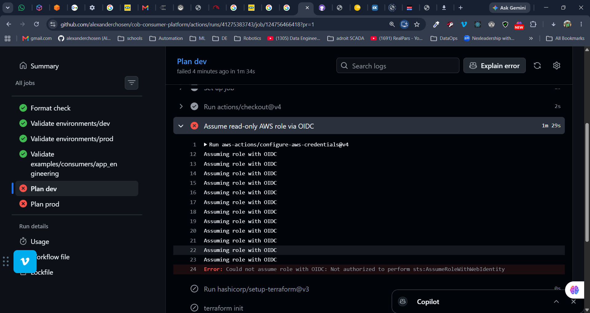
**The failure mode: a ninety-second retry loop ending in an error that names neither the real cause nor the claim that failed to match.**

**Expression interpolation into shell steps is a script injection vector.** `${{ }}` expressions are substituted into the script text before the shell parses it. A Terraform plan containing `(known after apply)` broke a step with a bash syntax error — and the same mechanism would execute arbitrary commands if the value were attacker-influenced. Every `run:` block in this pipeline now passes values through `env:`.

**A formatting gate decays unless local tooling makes it free.** The first pull request failed `terraform fmt -check` across every `.tf` file in the repository, largely on `=` alignment and missing trailing newlines. The fix is one command; the durable fix is `editor.formatOnSave` with the HashiCorp Terraform extension, so the check never fires again. CI enforces the standard; local tooling makes meeting it automatic.


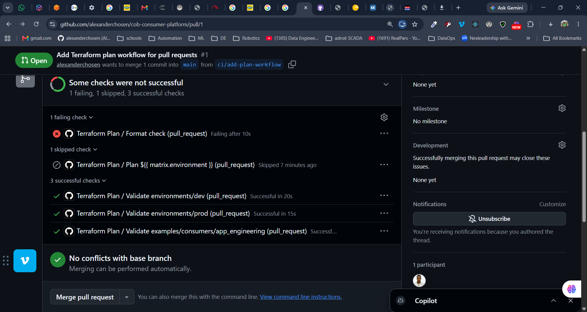
**`terraform fmt -check` exits 3 when files need formatting — distinct from exit 1, a genuine parse error.**

**Account closure makes state unrecoverable, and that is survivable.** The original AWS account was closed mid-project. The state bucket returned `AllAccessDisabled` — the error S3 gives when the owning account is suspended or closed, which no credential from any account can bypass. The old state was worthless anyway: it mapped configuration to resource IDs in an account whose resources no longer existed. The platform was rebuilt in a fresh account from code alone, which is a stronger claim about the code than any amount of surviving state would have been.

**The AWS free tier changed for new accounts.** Accounts created after 15 July 2025 no longer receive the twelve-month allowances; they receive credits instead. Cost-aware defaults inherited from COB 1 — NAT gateway off, Multi-AZ off — matter more under a credit model than under a usage allowance, and the data platform was chosen partly because S3, Glue and Athena consume almost none of it.

**A pull request is a bounded unit of change, and that is the point.** Commits pushed to a branch after its pull request is merged go nowhere; they need a new branch and a new pull request. This was initially confusing and is in fact what makes "this change was reviewed" a meaningful statement — the same reason *dismiss stale approvals on new commits* is enabled.

**Merge-triggered workflows cannot be tested before they are merged.** The apply workflow's first execution necessarily happened on `main`. `workflow_dispatch` provides a retry path, which is why it is declared.

---

## Getting started

### Prerequisites

- Terraform ≥ 1.10 — required for native S3 state locking
- AWS CLI v2 configured against the target account
- Repository access with permission to open pull requests

### One-time bootstrap

**1. Create the state bucket.** Choose a globally unique name.

```bash
aws s3api create-bucket --bucket YOUR-BUCKET-NAME --region eu-north-1 \
  --create-bucket-configuration LocationConstraint=eu-north-1

aws s3api put-bucket-versioning --bucket YOUR-BUCKET-NAME \
  --versioning-configuration Status=Enabled

aws s3api put-bucket-encryption --bucket YOUR-BUCKET-NAME \
  --server-side-encryption-configuration \
  '{"Rules":[{"ApplyServerSideEncryptionByDefault":{"SSEAlgorithm":"AES256"}}]}'

aws s3api put-public-access-block --bucket YOUR-BUCKET-NAME \
  --public-access-block-configuration \
  BlockPublicAcls=true,IgnorePublicAcls=true,BlockPublicPolicy=true,RestrictPublicBuckets=true
```

**2. Register GitHub as an OIDC identity provider.** IAM → Identity providers → Add provider → OpenID Connect. URL `https://token.actions.githubusercontent.com`, audience `sts.amazonaws.com`.

**3. Create the two roles** from the trust policies in `bootstrap/`. Check your repository's actual subject claim first — **Settings → Actions → OIDC** — and use it verbatim. If *Use immutable subject claim* is enabled, the subject includes numeric IDs and the name-based examples in AWS documentation will not match.

```bash
aws iam create-role --role-name cob-oidc-plan \
  --assume-role-policy-document file://bootstrap/trust-plan.json
aws iam attach-role-policy --role-name cob-oidc-plan \
  --policy-arn arn:aws:iam::aws:policy/ReadOnlyAccess

aws iam create-role --role-name cob-oidc-apply \
  --assume-role-policy-document file://bootstrap/trust-apply.json
aws iam attach-role-policy --role-name cob-oidc-apply \
  --policy-arn arn:aws:iam::aws:policy/AdministratorAccess
```

**4. Configure the repository.**

- **Settings → Environments** → create `dev` (no protection rules) and `prod` (required reviewers; deployment branches restricted to `main`).
- **Settings → Rules → Rulesets** → create a branch ruleset targeting the default branch: require a pull request with 1 approving review, dismiss stale approvals, require branches to be up to date, require the six status checks, block force pushes and deletions.

**5. Update the account ID** in the `PLAN_ROLE` and `APPLY_ROLE` environment variables in both workflow files.

### Local development

```bash
cd environments/dev
terraform init
terraform plan
```

Local credentials come from your own AWS CLI session. If you use `aws login`, refresh an expired session with `aws login --profile signin`. Nothing local is needed for the pipeline — GitHub Actions authenticates through OIDC.

**Do not run `terraform apply` locally.** Applies belong to the pipeline, where they are logged, locked, and attributed.
