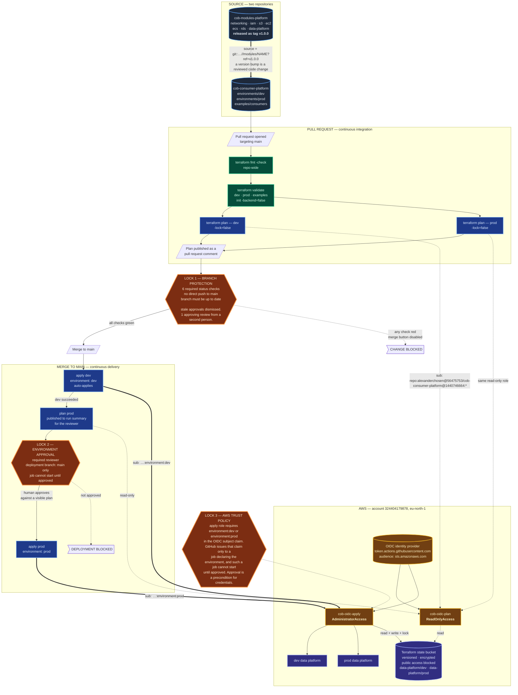
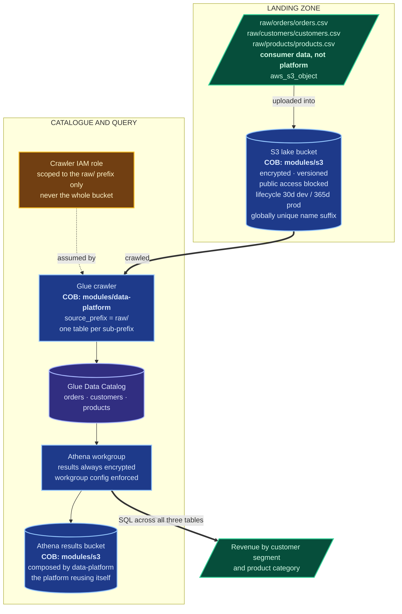
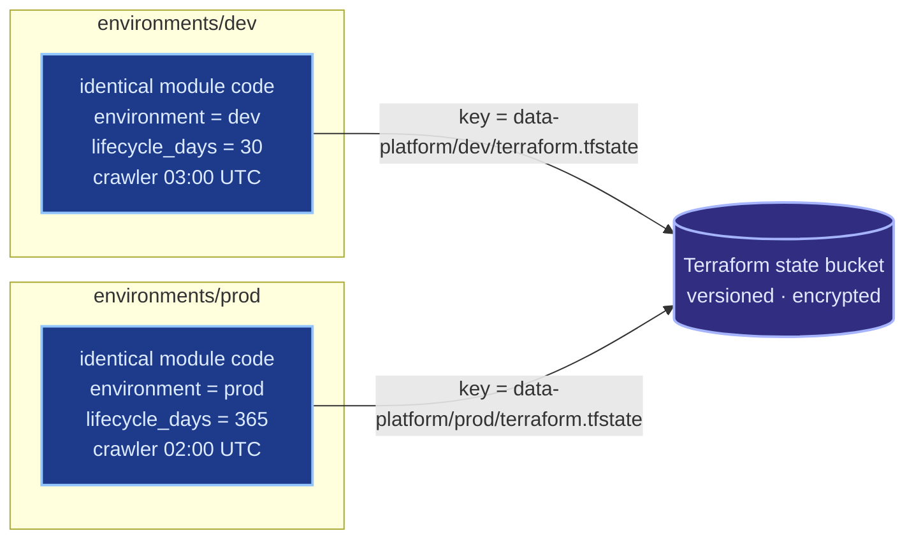

# COB 2 — Architecture Diagrams

Two diagrams. The first shows how a change travels from a pull request to
provisioned infrastructure, and where it is stopped. The second shows what
the pipeline actually builds and which COB module provisioned each piece.

---

## Diagram 1 — Delivery pipeline and trust boundaries

**Reading the diagram**

- **Green jobs need no AWS credentials at all.** `fmt` and `validate` run with
  `init -backend=false`, so a syntax error fails in about 20 seconds without a
  single cloud API call.
- **The dotted credential arrows carry the actual OIDC subject claims.** The
  plan jobs match a wildcard subject; the apply jobs match an exact
  `environment:` subject. That difference is Lock 3.
- **The three locks are independent.** Removing any one leaves the others
  standing.

---

## Diagram 2 — Provisioned data platform

Identical in shape for `dev` and `prod`; only input values and state keys differ.

**Reading the diagram**

- **Every box is tagged with the COB module that provisioned it.** Nothing in
  the data platform was hand-built around the platform.
- **The seed objects are deliberately not a COB capability.** COB provisions
  the bucket; what the consumer puts in it is application data. A platform
  module that uploaded these CSVs would be a platform that knows about this
  team's datasets.
- **The results bucket is `data-platform` calling `s3` internally** — the
  platform consuming its own capability the same way an external team does.

---

## Optional — Diagram 3, environment isolation

Small, and it answers "how do you know dev cannot damage prod?" at a glance.

Separate directories, separate state keys, one bucket. The backend block cannot
use variables, so the key is a literal per directory — which is precisely why
directories were chosen over workspaces for environment separation.
